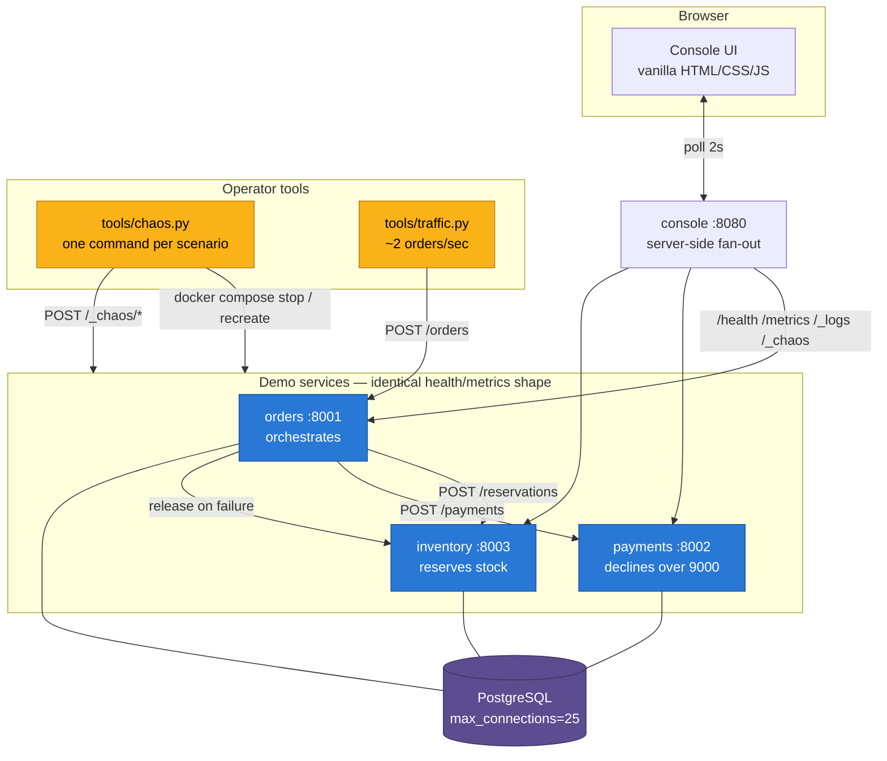

# AIOps Incident-Response Agent — Phase 1: the system that breaks

[](https://github.com/Katastrophe123/Trident---An-AIOps-Project/actions/workflows/ci.yml)

A small distributed system that can be broken on demand, in five specific ways,
and put back together again — plus the observability needed to tell those five
failures apart.

> **Phase 1 only.** There is no LLM and no agent in this repository yet. Phase 1
> builds the *patient*; Phase 2 builds the doctor. That split is deliberate: an
> incident-response agent can only be evaluated against a system whose failures
> have known root causes.

---

## The problem

An on-call engineer woken at 3am does roughly this: look at what is alerting,
read the logs, check the metrics, form a hypothesis, test it, fix it. The
interesting part is not the fix — it is the *diagnosis*, and specifically telling
apart failures that look identical from the outside:

- Orders are failing. Is a service down, or is it correctly refusing bad orders?
- Latency has tripled. Is this service slow, or is it waiting on one that is?
- A service reports a database error. Is *that* service broken, or is another one
  holding every connection?

To train or evaluate an agent on that, you need a system where you can inject a
failure whose root cause you already know, and check whether the diagnosis was
right. That system is what this repository is.

---

## Architecture



**One order touches all three services and the database**, which is what makes a
single injected fault produce a visible, traceable symptom:

1. `POST /orders` → orders reserves stock from inventory
2. orders charges payments
3. on a payment refusal, orders **releases the reservation** (so a long chaos run
   cannot silently drain the shelf)
4. orders writes the order with status `confirmed`, `rejected` or `failed`

An `X-Request-ID` is generated at the edge and forwarded on every internal call,
so one order's log lines correlate across three services.

---

## The five failure scenarios

Each has exactly one root cause, so a diagnosis can be scored.

| # | Command | Root cause | What it looks like |
|---|---|---|---|
| 1 | `chaos.py crash` | Container is not running | Connection refused; orders returns 502, orders are `failed` |
| 2 | `chaos.py bad-config` | Wrong `DATABASE_URL` password | Container **up**, `/health` 503 with an auth error |
| 3 | `chaos.py slow-dependency` | One service is slow | Latency climbs on the slow service *and* its caller |
| 4 | `chaos.py memory-leak` | Unbounded growth in-process | `memory_mb` climbs; requests stay fine |
| 5 | `chaos.py db-exhaustion` | Connections held and never returned | The *other* services fail to reach the database |

Scenario 5 is the interesting one: **the service reporting the error is not the
service at fault.**

`RUNBOOK.md` documents each one — how to inject it, the exact symptoms in logs
and metrics, and how to fix it by hand. Every scenario in it was run and the
output recorded.

---

## Tech stack

| Layer | Choice | Why |
|---|---|---|
| API | FastAPI (async) | Native async, generated OpenAPI docs |
| Validation | Pydantic v2 | Health/metrics shapes are a contract the agent parses |
| Config | pydantic-settings | One `ServiceSettings` per process, `.env.example` committed |
| Database | PostgreSQL 16 + SQLAlchemy 2 async (asyncpg) | Shared store makes the DB-exhaustion scenario real; `max_connections=25` and a non-superuser app role make it *reachable* |
| Migrations | Alembic (async env) | Verified up → down → up |
| Logging | stdlib `logging` + a ~40-line JSON formatter | No framework; the whole pipeline is readable in one sitting |
| Metrics | Hand-rolled in-process registry | Four readings as JSON; see `DECISIONS.md` §8 |
| Frontend | Vanilla HTML/CSS/JS — 3 files, no build step | Readable without frontend experience |
| Orchestration | Docker Compose | `docker compose up` and it works |
| Quality | ruff, mypy, pytest + coverage | Enforced in CI |

---

## Running it

### Prerequisites

Docker (Desktop or Colima) and nothing else — the stack itself needs no Python
on the host.

The operator tools (`tools/chaos.py`, `tools/traffic.py`) do run on the host and
need `httpx`, so use the project virtualenv for those:

```bash
python -m venv .venv && source .venv/bin/activate
pip install -e ".[dev]"
```

Every `python -m tools.…` command below assumes that environment is active. If
you would rather not activate it, call it explicitly: `.venv/bin/python -m tools.chaos status`.

### Start everything

```bash
docker compose up -d --build --wait
```

That starts PostgreSQL, the three services, the console, and a traffic generator
producing ~2 orders/second. No migration step, no seeding step — orders runs the
migration and inventory seeds its own stock on startup.

**Open the console: <http://localhost:8080>**

| Service | URL | Docs |
|---|---|---|
| console | <http://localhost:8080> | — |
| orders | <http://localhost:8001> | `/docs` |
| payments | <http://localhost:8002> | `/docs` |
| inventory | <http://localhost:8003> | `/docs` |

### Check the system state

```bash
python -m tools.chaos status
```

```
Demo system status
  orders     HEALTHY       req=56     err=0     lat=   30.2ms mem=  83.1MB
  payments   HEALTHY       req=56     err=0     lat=    4.7ms mem=  78.1MB
  inventory  HEALTHY       req=59     err=0     lat=   11.8ms mem=  78.5MB

  orders by status: {'confirmed': 53, 'rejected': 3}
  console: http://localhost:8080
```

Those few `rejected` orders are the designed baseline, not a fault: 4% of
generated orders are deliberately unservable. See `RUNBOOK.md`.

### Break it, then fix it

```bash
python -m tools.chaos crash            --service payments
python -m tools.chaos bad-config       --service payments
python -m tools.chaos slow-dependency  --service inventory --seconds 3
python -m tools.chaos memory-leak      --service orders
python -m tools.chaos db-exhaustion    --service payments --connections 20

python -m tools.chaos reset            # back to a known-good state
```

Each command prints the symptoms to expect and the manual fix. `reset` clears
config overrides, recreates the containers, clears in-process faults, restocks
inventory and re-checks health.

### Tear down

```bash
docker compose down -v
```

---

## curl examples

```bash
# Health — the endpoint the Phase 2 alert monitor polls
curl -s localhost:8001/health | jq

# Metrics — request count, error count, average latency, memory
curl -s localhost:8001/metrics | jq

# Recent logs, newest first (what the agent's get_logs tool will read)
curl -s 'localhost:8001/_logs?limit=5&level=WARNING' | jq

# Place an order
curl -s -X POST localhost:8001/orders \
  -H 'content-type: application/json' \
  -d '{"customer_id":"cust-0042","sku":"SKU-LAPTOP-13","quantity":1}' | jq

# A refusal, not an outage: 201 with status "rejected"
curl -s -X POST localhost:8001/orders \
  -H 'content-type: application/json' \
  -d '{"customer_id":"cust-0042","sku":"SKU-NOPE","quantity":1}' | jq

# Order counts by status
curl -s localhost:8001/orders/summary | jq

# Stock levels
curl -s localhost:8003/stock | jq

# Inject and clear a 3s delay in inventory
curl -s -X POST 'localhost:8003/_chaos/latency?milliseconds=3000' | jq
curl -s -X POST 'localhost:8003/_chaos/latency?milliseconds=0' | jq

# Correlate one order across all three services
curl -s -X POST localhost:8001/orders \
  -H 'content-type: application/json' -H 'X-Request-ID: trace-me-123' \
  -d '{"customer_id":"c","sku":"SKU-MOUSE-WL","quantity":1}' > /dev/null
curl -s 'localhost:8002/_logs?limit=20' | jq '.records[] | select(.request_id=="trace-me-123")'
```

---

## The console

Three static files, no framework, no npm, no build step:

| File | What it does |
|---|---|
| `index.html` | Structure. `<template>` blocks are cloned per service; `data-bind="…"` marks every spot the JS writes to. |
| `styles.css` | Colour tokens first, then layout. Light and dark. |
| `app.js` | Polls `/api/overview` every 2s and `/api/logs` every 4s, then fills in the `data-bind` targets. |

What it shows: a status pill per service (icon + word, never colour alone), four
stat tiles per service (requests, errors, latency, memory), a latency sparkline
built from the points the browser has collected, order counts by status, a merged
log table with service/level filters, and buttons for the three in-process
scenarios.

The two container-level scenarios show the command to copy instead of a button —
the console has no Docker socket, by design (`DECISIONS.md` §6).

---

## Testing

```bash
# Install
python -m venv .venv && source .venv/bin/activate
pip install -e ".[dev]"

# Everything the CI gate runs
ruff check .
ruff format --check .
mypy services tools
pytest --cov=services --cov=tools --cov-report=term-missing
```

**223 tests, 92% coverage.** No test needs Docker, PostgreSQL or a network: the
database is in-memory SQLite and the three services are mounted as ASGI apps
wired to each other with `httpx` transports, so `orders → inventory → database`
is exercised end to end in-process.

What the tests cover, and why those things:

| File | Focus |
|---|---|
| `test_services.py` | Endpoint behaviour, and above all **refusal vs outage** — a 402/404/409 produces a `rejected` order and a 201 |
| `test_observability.py` | The metrics and log shapes, which are a contract Phase 2 parses |
| `test_chaos.py` | The three in-process scenarios actually change the system, and `CHAOS_ENABLED=false` forbids injection |
| `test_console.py` | Server-side fan-out, and that a **down service is reported rather than raised** |
| `test_tools.py` | Which compose command each scenario issues, override-file contents, and that the traffic generator treats a failure as a data point |

Several of those tests exist because something was genuinely broken:
`test_the_override_key_matches_what_the_compose_file_interpolates` guards an
injection that silently did nothing, and `TestReplenishment` guards a demo that
degraded to all-rejected after ten minutes.

Not unit-tested, deliberately: actually stopping a container. Faking
`docker compose stop` would only test the mock, so those two scenarios are
verified by hand and the walkthrough is recorded in `RUNBOOK.md`.

---

## Design decisions

The reasoning for every non-obvious choice is in **`DECISIONS.md`**. The ones
worth knowing before reading the code:

1. **A refusal is not an outage.** Declined payment, unknown SKU and
   insufficient stock are 4xx and produce `rejected` orders with a 201. Only a
   genuinely unreachable dependency is a 502 and a `failed` order. Only 5xx
   counts as an error. The traffic generator deliberately makes 4% of orders
   unservable, so a baseline of legitimate 4xx is normal.
2. **Chaos uses two mechanisms** — the Compose CLI for container-level faults,
   HTTP for in-process ones — because a "slow dependency" injected by restarting
   a container is a different failure.
3. **Postgres runs with `max_connections=25`** so exhaustion is reachable in
   seconds rather than by holding hundreds of connections.
4. **The entrypoint does not exit when the database is unreachable**, so
   bad-config is diagnosable instead of a crash loop.
5. **The injected delay is inside the latency timer**, so a slow service reports
   *itself* as slow. (Found by a failing test; it was the other way around first.)
6. **The log buffer is bounded**, because one of the scenarios is a memory leak
   and an unbounded buffer would be a second one. `uvicorn.access` is suppressed
   because it duplicates the middleware's own structured access log.
7. **Services connect as a non-superuser role.** PostgreSQL does not enforce
   `max_connections` against superusers, which made the exhaustion scenario
   genuinely broken and completely invisible.
8. **Inventory replenishes depleted stock**, or the demo has a shelf life of
   about ten minutes and three scenarios quietly lose their symptoms.

Three of the five scenarios needed a code change before they produced the
symptom they were supposed to. Each failure is written up in `RUNBOOK.md` under
"what went wrong building this", because the wrong behaviour is the instructive
part.

---

## Limitations

- **The memory leak is reclaimed by `reset`.** A real one would not be. The
  honest fix, and the one the RUNBOOK gives, is `docker compose restart`.
- **No authentication.** Not asked for in Phase 1; the stack binds to localhost.
  `CHAOS_ENABLED` is a demo switch, not a security boundary.
- **Metrics and logs are in-process and in-memory.** They reset with the
  container and would not survive more than one replica.
- **One replica per service**, one database, no connection retries anywhere —
  retries would mask exactly the failures being injected.
- **No repository URL yet**, because no git operations were permitted
  (`DECISIONS.md` §1).
- **`pool_recycle` is deliberately short (30s).** Good practice regardless, but
  the short interval is a demo choice.
- **Order history is cumulative** and `reset` does not clear it, so error counts
  and `orders by status` include every previous scenario. `docker compose down -v`
  for a genuinely clean slate.

---

## Future work

**Phase 2 — the agent** (not started; waiting on explicit instruction):

- A LangGraph agent with tools over the surfaces Phase 1 exposes:
  `get_health`, `get_metrics`, `get_logs`, `get_container_status`,
  `restart_container`
- An alert monitor polling `/health` and triggering the graph on a state change
- Diagnosis → proposed remediation → gated execution, with a run trace

**Phase 3 — evaluation:** inject a known scenario, capture the agent's diagnosis,
score it against the known root cause. This is why each scenario has exactly one.

**Beyond:** OpenTelemetry traces (the request-id propagation is already the hard
part), a scenario where two faults overlap, and a scenario whose correct answer
is "nothing is wrong" — the hardest case for an agent that wants to be useful.
