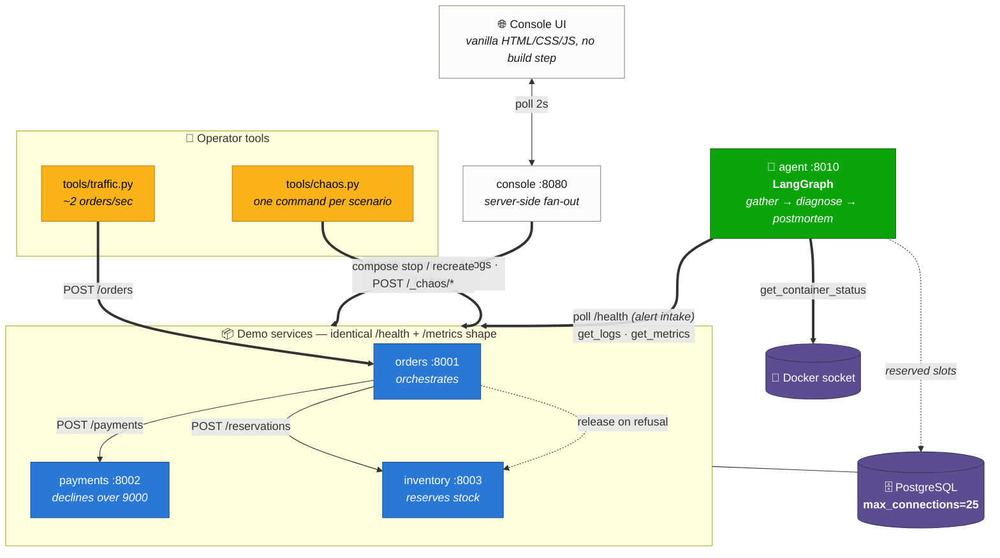
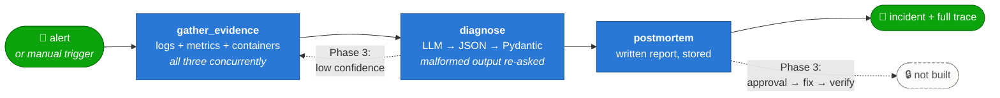

<div align="center">

# 🛠️ Trident — AIOps Incident-Response Agent

**A distributed system that breaks on purpose, and an AI agent that diagnoses it the way an on-call engineer would.**

[](https://github.com/Katastrophe123/Trident---An-AIOps-Project/actions/workflows/ci.yml)
[](https://www.python.org/)
[](#-testing)
[](#coverage-by-module)
[](#-testing)
[](#-roadmap)

[Results](#-what-the-agent-actually-concluded) · [Architecture](#-architecture) · [Quick start](#-quick-start) · [The agent](#-phase-2-the-agent) · [Decisions](#-design-decisions) · [Limitations](#-limitations)

</div>

---

> [!NOTE]
> **Every number in this README was measured, not estimated.** The scenario
> results, latencies, memory figures and node timings below are copied from runs
> against the live stack. Where a figure comes from the rule-based baseline
> rather than a language model, it says so.

---

## 🎯 What the agent actually concluded

Each of the five failure scenarios was injected into the running system and the
agent's own answer recorded verbatim.

| # | Scenario | Investigation started by | Alerted on | **Agent blamed** | Confidence | Verdict |
|:-:|:---|:---|:---|:---|:-:|:-:|
| 1 | Crashed service | 🤖 monitor (`unreachable`) | `payments` | **`payments`** | `0.95` | ✅ correct |
| 2 | Bad config | 🤖 monitor (`unhealthy`) | `payments` | **`payments`** | `0.90` | ✅ correct |
| 3 | Slow dependency | 👤 manual | `orders` | **`inventory`** | `0.75` | ✅ correct |
| 4 | Memory leak | 👤 manual | `orders` | **`orders`** | `0.60` | ✅ correct |
| 5 | **Database exhaustion** | 🤖 monitor (`unhealthy`) | `inventory` | **`payments`** | `0.80` | ✅ correct |
| — | *Nothing wrong* | 👤 manual | `orders` | *— escalated* | `0.25` | ✅ abstained |

**5 of 5 root causes identified, and no false positive on a healthy system.**

<table>
<tr><td width="50%" valign="top">

### 🏆 The case that matters

Scenario 5 is where pattern-matching fails and diagnosis begins. Measured during
the run:

| Service | `errors` | `held_db_connections` |
|:---|:-:|:-:|
| `orders` | **51** | 0 |
| `inventory` | **51** | 0 |
| `payments` | `0` | **20** |

The alert fired on `inventory`. The agent blamed `payments` — which was
reporting **zero errors of its own** while holding 20 of the database's 25
connection slots.

> *"PostgreSQL has no connection slots left; payments is holding them and is the service at fault."*

**The loudest victim is not the culprit.**

</td><td width="50%" valign="top">

### 🤫 The case most agents fail

Given a healthy system — including its designed baseline of ~4% deliberate 4xx
refusals — the agent was asked to investigate anyway:

```
status     : escalated
confidence : 0.25
scenario   : None
cause      : No single root cause identified
             from the available evidence.
```

It declined to invent a cause. A confidently wrong diagnosis is worse than an
honest *"insufficient evidence"*, and this is the branch Phase 3 uses to go back
for more.

</td></tr>
</table>

---

## 🧩 The problem

An on-call engineer woken at 3am does roughly this: look at what is alerting,
read the logs, check the metrics, form a hypothesis, test it, fix it. The
interesting part is not the fix — it is the **diagnosis**, and specifically
telling apart failures that look identical from the outside:

| The symptom | The ambiguity |
|:---|:---|
| Orders are failing | Is a service down, or correctly *refusing* bad orders? |
| Latency has tripled | Is this service slow, or *waiting* on one that is? |
| A service reports a DB error | Is *that* service broken, or is another holding every connection? |

To evaluate an agent on that you need a system where you can inject a failure
whose root cause you already know, then check whether the diagnosis was right.
That system is what this repository is.

---

## 🏗 Architecture



**One order touches all three services and the database**, which is what makes a
single injected fault produce a visible, traceable symptom:

```
POST /orders  →  reserve stock (inventory)  →  charge (payments)  →  write order
                        ↑                            │
                        └──── release on refusal ────┘
```

An `X-Request-ID` is generated at the edge and forwarded on every internal call,
so one order's log lines correlate across three services:

```json
{"event":"downstream_ok","downstream":"inventory","path":"/reservations","latency_ms":11.23,"request_id":"c01f01a9..."}
{"event":"downstream_ok","downstream":"payments","path":"/payments","latency_ms":6.31,"request_id":"c01f01a9..."}
{"event":"order_confirmed","request_id":"c01f01a9..."}
{"event":"request_completed","path":"/orders","status_code":201,"latency_ms":20.89,"request_id":"c01f01a9..."}
```

---

## 🤖 Phase 2: the agent



An **alert monitor** polls every service's `/health`. After two consecutive
failures it opens an incident and runs the graph. `POST /incidents` triggers one
by hand.

> [!IMPORTANT]
> **Phase 2 is diagnosis-only, deliberately.** The plan's build order is
> explicit: *"get the diagnosis right before the agent is allowed to act."* The
> agent reads logs, metrics and container state. It **cannot** restart or
> reconfigure anything — the two mutating tools live on a separate class that no
> graph node imports.

### Measured node timings

From a verbatim monitor-driven incident (`crashed_service`):

| # | Node | Status | Latency | What it found |
|:-:|:---|:-:|---:|:---|
| 1 | `gather_evidence` | ✅ ok | **144.2 ms** | 80 log records · `unreachable: [payments]` · `not_running: [payments]` |
| 2 | `diagnose` | ✅ ok | **1.2 ms** | `scenario=crashed_service` · `confidence=0.95` |
| 3 | `postmortem` | ✅ ok | **0.2 ms** | report stored |

Evidence gathering dominates — three services × two HTTP calls plus a Docker
round trip, run concurrently. The 1.2 ms diagnose step is the **rule-based
baseline**; a real model adds network latency there.

### 🔐 Why the tools are an allowlist

Five named tools, each a typed Python function. The model's output is **data**
that gets validated; a `proposed_action` naming anything outside the registry is
dropped with a warning rather than attempted.

| Tool | Risk | Reachable from the graph? |
|:---|:---|:---|
| `get_logs` | 🟢 safe | ✅ yes |
| `get_metrics` | 🟢 safe | ✅ yes |
| `get_container_status` | 🟢 safe | ✅ yes |
| `restart_container` | 🔴 risky | ⛔ **no** — needs the Phase 3 approval gate |
| `rollback_config` | 🔴 risky | ⛔ **no** — needs the Phase 3 approval gate |

```bash
curl -s localhost:8010/tools | jq -r '.[] | "\(.name)\t\(.risk)\tin-graph=\(.enabled_in_graph)"'
```
```
get_logs               safe   in-graph=True
get_metrics            safe   in-graph=True
get_container_status   safe   in-graph=True
restart_container      risky  in-graph=False
rollback_config        risky  in-graph=False
```

The allowlist is **published** so the restriction is inspectable rather than a
claim in a README. An unknown tool name is treated as *risky*, not safe — fail
closed. The alternative, a shell plus a prompt asking the model to be careful,
fails the first time a log line reads like an instruction. **An allowlist cannot
be argued out of its own contents.**

### Diagnosis without an API key

> [!WARNING]
> With no `LLM_API_KEY` set, the agent runs a **deterministic rule-based
> provider** and labels every diagnosis `source: "stub"` — in the API, the
> stored incident, the postmortem body, and on `/health` as a `degraded`
> dependency. **The results table above is the stub's.** It is never dressed up
> as a model's work.

That is not only a convenience. It is the **baseline** the Phase 4 evaluation
needs: *"the agent diagnosed 5/5"* means little next to *"a page of if-statements
also diagnosed 5/5"*. Getting a real model to beat it is Phase 4's job — and if
it cannot, that is the interesting finding.

```bash
# Any OpenAI-compatible endpoint: Groq, Together, vLLM, Ollama, OpenAI
LLM_PROVIDER=openai LLM_API_KEY=gsk_... docker compose up -d agent
```

<details>
<summary><b>🔎 Agent endpoints</b> — click to expand</summary>

| Endpoint | Purpose |
|:---|:---|
| `POST /incidents` | Trigger an investigation by hand |
| `GET /incidents` | List incidents (filter by `status`, `service`) |
| `GET /incidents/{id}` | **Full trace**: every node, its evidence, its decision |
| `GET /incidents/{id}/postmortem` | The written report |
| `GET /tools` | The tool allowlist and each tool's risk |
| `GET /health` · `/metrics` · `/_logs` | Same surface as every other service |

```bash
# Investigate right now and print the conclusion
curl -s -X POST localhost:8010/incidents \
  -H 'content-type: application/json' \
  -d '{"service":"payments","trigger":"manual check"}' \
  | jq '.incident | {root_cause, root_cause_service, confidence, status}'

# The audit trail of the most recent incident
ID=$(curl -s 'localhost:8010/incidents?limit=1' | jq -r '.[0].id')
curl -s "localhost:8010/incidents/$ID" | jq '.steps[] | {node, status, latency_ms, output}'

# Proposed actions — recorded, never executed in Phase 2
curl -s "localhost:8010/incidents/$ID" | jq '.actions'
```

**Phase 3 will add** `POST /incidents/{id}/approve` and `/reject`. They are
absent rather than stubbed: an endpoint that accepts an approval and does
nothing with it implies a gate that does not exist.

</details>

---

## 💥 The five failure scenarios

Each has exactly **one** root cause, so a diagnosis can be scored.

| # | Command | Root cause | Signature |
|:-:|:---|:---|:---|
| 1 | `chaos.py crash` | Container is not running | Container `Exited`; callers get connection errors; orders are `failed` |
| 2 | `chaos.py bad-config` | Wrong `DATABASE_URL` password | Container **`Up`**; `/health` **503** with an auth error |
| 3 | `chaos.py slow-dependency` | One service is slow | Latency climbs on it *and* its caller; **`errors` stay 0** |
| 4 | `chaos.py memory-leak` | Unbounded growth in-process | `memory_mb` climbs; everything else normal |
| 5 | `chaos.py db-exhaustion` | Connections held, never returned | The **other** services fail; the culprit reports nothing |

<details>
<summary><b>📊 Measured symptoms</b> — the readings each scenario actually produced</summary>

#### 1 · Crashed service — `orders` while `payments` is down

```
requests=118  errors=71  error_rate=0.6017
downstream_errors={'payments': 71}
status_counts={'2xx': 47, '5xx': 71}
orders by status: {"confirmed":37530,"failed":775,"rejected":1655}
```

`failed`, **not** `rejected` — the distinction the whole system is built around.

#### 3 · Slow dependency — 3 s injected into `inventory`

| Service | Before | After | |
|:---|---:|---:|:---|
| `orders` | 29.2 ms | **3086.3 ms** | `████████████████████` waits on inventory |
| `inventory` | 11.6 ms | **3020.9 ms** | `███████████████████▌` ← **the cause** |
| `payments` | 6.0 ms | **5.6 ms** | `▏` untouched |

`errors = 0` everywhere. **Slow is not failing** — an agent hunting for errors
finds nothing. Note that `inventory` reports *itself* as slow, which is what
points the diagnosis at the right service rather than at its caller.

#### 4 · Memory leak — `orders`

| Elapsed | `memory_mb` | |
|---:|---:|:---|
| 0 s | 84.1 | `███` |
| 12 s | 184.1 | `██████▌` |
| 24 s | 280.1 | `██████████` |
| 36 s | 372.1 | `█████████████` |
| 48 s | 468.1 | `████████████████▌` |
| 60 s | 564.1 | `████████████████████` |

Monotonic, ≈ 8 MB/s. `requests` keep succeeding, `errors` stay 0, latency
unchanged. **`memory_mb` is the only signal** — which is why this one scores the
lowest confidence of the five (`0.60`): a single snapshot cannot distinguish a
leak from a busy service.

#### 5 · Database exhaustion

```
orders     UNHEALTHY  errors=51  held_db_connections=0
payments   UNHEALTHY  errors=0   held_db_connections=20   ← at fault
inventory  UNHEALTHY  errors=51  held_db_connections=0
```

All three `/health` return **503** with the same error. Only the held-connection
count identifies the culprit.

**Full write-ups, including the four failed attempts it took to make this
scenario work at all, are in [`RUNBOOK.md`](RUNBOOK.md).**

</details>

---

## 🚀 Quick start

> **Prerequisites:** Docker (Desktop or Colima). Nothing else — the stack itself
> needs no Python on the host.

```bash
git clone git@github.com:Katastrophe123/Trident---An-AIOps-Project.git
cd Trident---An-AIOps-Project

# The agent needs the group that owns the Docker socket
export DOCKER_SOCK_GID=$(stat -f '%g' /var/run/docker.sock)   # Linux: stat -c '%g'

docker compose up -d --build --wait
```

That one command starts PostgreSQL, the app role, the migration, stock seeding,
three services, the console, the agent and a traffic generator. **No manual
steps.**

| | Service | URL | Docs |
|:-:|:---|:---|:---|
| 🖥 | **console** | <http://localhost:8080> | — |
| 🤖 | **agent** | <http://localhost:8010> | `/docs` |
| 📦 | orders | <http://localhost:8001> | `/docs` |
| 💳 | payments | <http://localhost:8002> | `/docs` |
| 📋 | inventory | <http://localhost:8003> | `/docs` |

### Break it, watch the agent, put it back

```bash
source .venv/bin/activate        # the operator tools need httpx

python -m tools.chaos status                                           # where things stand
python -m tools.chaos crash            --service payments              # 🤖 monitor alerts
python -m tools.chaos bad-config       --service payments              # 🤖 monitor alerts
python -m tools.chaos slow-dependency  --service inventory --seconds 3 # 👤 manual trigger
python -m tools.chaos memory-leak      --service orders                # 👤 manual trigger
python -m tools.chaos db-exhaustion    --service payments --connections 20  # 🤖 monitor alerts
python -m tools.chaos reset                                            # back to known-good
```

A healthy baseline, verbatim:

```
Demo system status
  orders     HEALTHY       req=28     err=0     lat=   29.0ms mem=  83.9MB
  payments   HEALTHY       req=25     err=0     lat=    6.0ms mem=  78.8MB
  inventory  HEALTHY       req=29     err=0     lat=   10.3ms mem=  78.9MB

  orders by status: {'confirmed': 37512, 'failed': 704, 'rejected': 1655}
  console: http://localhost:8080
```

> [!TIP]
> Those `rejected` orders are the **designed baseline, not a fault**: 4% of
> generated orders are deliberately unservable (unknown SKU → 404, over-limit
> amount → 402). An agent that flags them is wrong. Order counts are cumulative
> — the figures above come from a stack that had been up 16 hours.

```bash
docker compose down -v           # tear down, including order history
```

<details>
<summary><b>📡 curl examples</b> — the demo system</summary>

```bash
# Health — the endpoint the agent's monitor polls
curl -s localhost:8001/health | jq

# Metrics — request count, error count, latency, memory
curl -s localhost:8001/metrics | jq

# Recent logs, newest first (what get_logs reads)
curl -s 'localhost:8001/_logs?limit=5&level=WARNING' | jq

# Place an order
curl -s -X POST localhost:8001/orders \
  -H 'content-type: application/json' \
  -d '{"customer_id":"cust-0042","sku":"SKU-LAPTOP-13","quantity":1}' | jq

# A refusal, not an outage: 201 with status "rejected"
curl -s -X POST localhost:8001/orders \
  -H 'content-type: application/json' \
  -d '{"customer_id":"cust-0042","sku":"SKU-NOPE","quantity":1}' | jq

curl -s localhost:8001/orders/summary | jq     # counts by status
curl -s localhost:8003/stock | jq              # stock levels

# Inject and clear a 3s delay in inventory
curl -s -X POST 'localhost:8003/_chaos/latency?milliseconds=3000' | jq
curl -s -X POST 'localhost:8003/_chaos/latency?milliseconds=0' | jq

# Correlate one order across all three services
curl -s -X POST localhost:8001/orders \
  -H 'content-type: application/json' -H 'X-Request-ID: trace-me-123' \
  -d '{"customer_id":"c","sku":"SKU-MOUSE-WL","quantity":1}' > /dev/null
curl -s 'localhost:8002/_logs?limit=20' \
  | jq '.records[] | select(.request_id=="trace-me-123")'
```

</details>

---

## 🖥 The console

Three static files — **1,065 lines total**. No npm, no framework, no build step.

| File | What it does |
|:---|:---|
| `index.html` | Structure. `<template>` blocks cloned per service; `data-bind` marks every spot the JS writes to |
| `styles.css` | Colour tokens first, then layout. Light and dark |
| `app.js` | Polls `/api/overview` every 2 s and `/api/logs` every 4 s |

A status pill per service (**icon + word, never colour alone**), four stat tiles
each (requests, errors, latency, memory), a latency sparkline, order counts by
status, a merged log table with filters, and buttons for the three in-process
scenarios.

The two container-level scenarios show the command to copy instead of a button —
the console has no Docker socket, by design ([`DECISIONS.md`](DECISIONS.md) §6).

---

## 🧰 Tech stack

| Layer | Choice | Why |
|:---|:---|:---|
| API | **FastAPI** (async) | Native async, generated OpenAPI docs |
| Validation | **Pydantic v2** | Health/metrics shapes are a contract the agent parses |
| Config | **pydantic-settings** | One settings object per process; `.env.example` committed |
| Database | **PostgreSQL 16** + SQLAlchemy 2 async (asyncpg) | Shared store makes DB exhaustion real; `max_connections=25` and a non-superuser app role make it *reachable* |
| Migrations | **Alembic** (async env) | Verified up → down → up, `alembic check` clean |
| Agent | **LangGraph 1.x** | Typed state, and the graph shape the plan specifies |
| LLM | **`openai` SDK** against any compatible endpoint | Groq, Together, vLLM, Ollama or OpenAI — swappable by config |
| Containers | **`docker` Python SDK** | Matched by compose *label*, not name |
| Logging | stdlib `logging` + a ~40-line JSON formatter | No framework; the whole pipeline reads in one sitting |
| Metrics | Hand-rolled in-process registry | Four readings as JSON ([`DECISIONS.md`](DECISIONS.md) §8) |
| Frontend | Vanilla HTML/CSS/JS | Readable without frontend experience |
| Quality | **ruff · mypy · pytest** | Enforced in CI |

---

## 🧪 Testing

```bash
python -m venv .venv && source .venv/bin/activate
pip install -e ".[dev]"

ruff check . && ruff format --check .
mypy services tools
pytest --cov=services --cov=tools --cov-report=term-missing
```

<div align="center">

**361 tests · 92% coverage · mypy clean**
**6,595 lines of source · 4,732 lines of tests**

</div>

No test needs Docker, PostgreSQL, a network **or an API key**. The database is
in-memory SQLite, the three services are mounted as ASGI apps wired to each
other with `httpx` transports, and the diagnose node runs against a scripted
provider that can be told to return good JSON, malformed JSON, a schema
violation or an outright outage.

| Test file | Tests | Focus |
|:---|:-:|:---|
| `test_tools.py` | 89 | Which compose command each scenario issues; override files; traffic generator |
| `test_observability.py` | 42 | Metrics and log shapes — a contract the agent parses |
| `test_agent_tools.py` | 42 | The allowlist (including near-miss names); every tool reports failure as *evidence* |
| `test_services.py` | 39 | Endpoint behaviour, and above all **refusal vs outage** |
| `test_agent_api.py` | 36 | Endpoints, audit trail, alert monitor, **surviving the loss of its own database** |
| `test_console.py` | 32 | Server-side fan-out; a **down service is reported, not raised** |
| `test_chaos.py` | 29 | The three in-process scenarios, and that `CHAOS_ENABLED=false` forbids injection |
| `test_agent_graph.py` | 26 | All three nodes, every failure path, and all five scenarios against real readings |
| `test_agent_llm.py` | 26 | JSON extraction from fenced/prose replies; validation; retries; provider outages **not** retried |

<details>
<summary><b id="coverage-by-module">📈 Coverage by module</b></summary>

| Module | Stmts | Miss | Cover |
|:---|---:|---:|---:|
| `services/agent/schemas.py` | 125 | 0 | **100%** |
| `services/agent/prompts.py` | 33 | 0 | **100%** |
| `services/agent/state.py` | 38 | 0 | **100%** |
| `services/agent/config.py` | 29 | 0 | **100%** |
| `services/agent/stub_provider.py` | 127 | 7 | 94% |
| `services/agent/graph.py` | 121 | 9 | 93% |
| `services/agent/repository.py` | 104 | 8 | 92% |
| `services/agent/tools.py` | 156 | 19 | 88% |
| `services/agent/llm.py` | 107 | 16 | 85% |
| `services/agent/main.py` | 154 | 28 | 82% |
| `services/common/metrics.py` | 91 | 0 | **100%** |
| `services/common/models.py` | 91 | 0 | **100%** |
| `services/common/schemas.py` | 100 | 0 | **100%** |
| `services/common/logging_setup.py` | 83 | 2 | 98% |
| `services/common/config.py` | 34 | 1 | 97% |
| `services/common/chaos.py` | 106 | 5 | 95% |
| `services/common/app.py` | 166 | 12 | 93% |
| `services/common/db.py` | 53 | 6 | 89% |
| `services/common/http.py` | 72 | 11 | 85% |
| `services/console/main.py` | 139 | 6 | 96% |
| `services/inventory/main.py` | 135 | 17 | 87% |
| `services/orders/main.py` | 107 | 13 | 88% |
| `services/payments/main.py` | 49 | 6 | 88% |
| `tools/compose.py` | 52 | 0 | **100%** |
| `tools/traffic.py` | 111 | 4 | 96% |
| `tools/chaos.py` | 220 | 44 | 80% |
| **TOTAL** | **2,603** | **214** | **92%** |

Uncovered code is concentrated in `create_app`/lifespan wiring and
`chaos.py reset`, which the live walkthrough exercises instead.

</details>

> [!NOTE]
> **Not unit-tested, deliberately:** actually stopping a container. Faking
> `docker compose stop` would only test the mock, so those two scenarios are
> verified by hand and the walkthrough is recorded in [`RUNBOOK.md`](RUNBOOK.md).

---

## 🧠 Design decisions

Full reasoning for every non-obvious choice is in
**[`DECISIONS.md`](DECISIONS.md)** (33 entries). The ones worth knowing before
reading the code:

<details open>
<summary><b>Phase 1 — the system</b></summary>

1. **A refusal is not an outage.** Declined payment, unknown SKU and
   insufficient stock are 4xx → `rejected` orders with a **201**. Only a
   genuinely unreachable dependency is a **502** and a `failed` order. Only 5xx
   increments the error counter.
2. **Chaos uses two mechanisms** — the Compose CLI for container-level faults,
   HTTP for in-process ones — because a "slow dependency" injected by restarting
   a container is a *different* failure.
3. **Postgres runs with `max_connections=25`** and the services connect as a
   **non-superuser** role, because PostgreSQL does not enforce that limit
   against superusers — which made the exhaustion scenario genuinely broken and
   completely invisible.
4. **The entrypoint does not exit when the database is unreachable**, so
   bad-config is diagnosable instead of a crash loop.
5. **The injected delay is inside the latency timer**, so a slow service reports
   *itself* as slow. (Found by a failing test; it was the other way around first.)
6. **The log buffer is bounded** — one of the scenarios *is* a memory leak, and
   an unbounded buffer would be a second one.

</details>

<details open>
<summary><b>Phase 2 — the agent</b></summary>

7. **Tools are an allowlist, and the risky ones live on a different class** with
   no path from any graph node. Unknown names are treated as risky — fail closed.
8. **The stub provider is a baseline, not a mock**, and is labelled in four
   places so it can never be mistaken for a model.
9. **The agent connects as the superuser.** During DB exhaustion it is *also a
   victim* — it was refused connections, went 503, and could not open an
   incident for the fault it existed to diagnose. It now takes PostgreSQL's
   reserved operator slots, and persistence is best-effort.
10. **A transitional container is not a crashed one.** `created`/`restarting`
    now read as a deploy in progress at low confidence, not a crash at 0.95.
11. **Recovery resolves an incident** — otherwise the first incident per service
    silenced the monitor for that service forever.
12. **Persistence happens after the graph, not inside the nodes**, which keeps
    nodes pure and testable. The trade-off: a process that dies mid-investigation
    leaves no trace. Phase 3's checkpointer fixes that.

</details>

> **Four of those were found by running the system, not by reasoning about it.**
> Each is written up with the wrong behaviour it replaced, because the wrong
> behaviour is the instructive part.

---

## ⚠️ Limitations

Stated rather than hidden.

| Limitation | Detail |
|:---|:---|
| **The agent shares a database with its targets** | Mitigated via reserved slots + best-effort persistence. A production design would give it its own database. |
| **`degraded` does not raise an alert** | Slow dependency and memory leak report degraded while still serving, so they need a manual trigger. Alerting on degraded would fire before any symptom exists. |
| **One metric reading, not a trend** | Why the memory-leak diagnosis is the weakest (0.60). Storing history would fix it. |
| **`:ro` on the Docker socket does not make the API read-only** | Anything that can reach the socket can stop containers. The real restriction is that no mutating tool is reachable from the graph. |
| **The memory leak is reclaimed by `reset`** | A real one would not be. The honest fix in the runbook is `docker compose restart`. |
| **No authentication anywhere** | Not asked for in Phase 1–2; the stack binds to localhost. `CHAOS_ENABLED` is a demo switch, not a security boundary. |
| **Metrics and logs are in-process** | They reset with the container and would not survive more than one replica. |
| **Order history is cumulative** | `reset` does not clear it. `docker compose down -v` for a true clean slate. |
| **No retries anywhere** | Deliberate — retries would mask exactly the failures being injected. |

---

## 🗺 Roadmap

- [x] **Phase 1 — the demo system.** Three services, structured logs, metrics, Compose, traffic generator, chaos script, console. *Every scenario broken and fixed by hand.*
- [x] **Phase 2 — the basic agent.** Tools, a linear graph (gather → diagnose → postmortem), structured diagnosis, persistence, the alert monitor and the API. *5/5 scenarios diagnosed.*
- [ ] **Phase 3 — actions and control flow.**
  - [ ] Evidence gathering as three parallel nodes, each able to fail and retry alone
  - [ ] Approval gate: safe actions auto-run, risky ones raise a LangGraph interrupt and wait for `POST /incidents/{id}/approve`
  - [ ] Apply fix → verify health → loop back to diagnose, capped at 3 attempts, then escalate
  - [ ] The low-confidence branch *(the condition is already computed and recorded as `needs_more_evidence` — only the edge is missing)*
  - [ ] PostgreSQL checkpointing, so a paused investigation is resumable
- [ ] **Phase 4 — proof.** Run every scenario 3× and report root-cause accuracy, correct-fix rate, time to resolution and escalation rate — **against the rule-based stub as the baseline**, so the number means something.

**Beyond:** OpenTelemetry traces (request-id propagation is already the hard
part), a scenario where two faults overlap, and a scenario whose correct answer
is *"nothing is wrong"* — the hardest case for an agent that wants to be useful.

---

<div align="center">

**[`RUNBOOK.md`](RUNBOOK.md)** — per-scenario symptoms and manual fixes
**[`DECISIONS.md`](DECISIONS.md)** — why anything is the way it is

</div>
